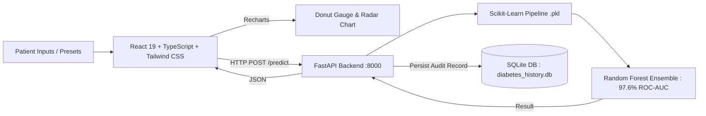

# DiaPredict AI: Clinical Diabetes Risk Assessment & ML Analytics
## Academic Project Report

**Domain:** Healthcare Informatics & Predictive Modeling  
**Academic Level:** College / University Engineering Project  
**Tech Stack:** Python, Scikit-Learn, FastAPI, SQLite, React 19, TypeScript, Recharts, Tailwind CSS v3  

---

### Executive Summary

**DiaPredict AI** is an end-to-end clinical diabetes risk prediction and analytical platform built on 100,000 patient records. The platform benchmarks **Logistic Regression**, **Decision Tree Classifier**, and an ensemble **Random Forest Classifier** within a leak-free Scikit-Learn `Pipeline` incorporating biological zero-imputation, standard scaling, and one-hot encoding.

The champion **Random Forest model** achieved **97.58% ROC-AUC**, **91.07% Accuracy**, and **90.12% Recall**. The model is served via a **FastAPI** REST backend integrated with a local **SQLite** database (`data/diabetes_history.db`) for patient audit trails. The frontend is built with **React 19**, **TypeScript**, **Recharts**, and **Tailwind CSS v3**, featuring interactive semi-circle risk gauges, biomarker radar deviation charts, model benchmark visualizations, and cohort screening.

---

### Key Highlights & Verified Metrics

| Metric | Logistic Regression | Decision Tree | Random Forest (Champion) |
| :--- | :---: | :---: | :---: |
| **Accuracy** | 88.88% | 88.45% | **91.07%** |
| **Recall (Sensitivity)** | 89.35% | **92.88%** | **90.12%** |
| **Precision** | 42.64% | 41.89% | **48.63%** |
| **F1-Score** | 57.73% | 57.74% | **63.18%** |
| **ROC-AUC Score** | 96.29% | 97.42% | **97.58%** |

#### Confusion Matrix ($N = 20,000$ Holdout Test Set):
* **True Negatives (TN):** $16,682$
* **False Positives (FP):** $1,618$
* **False Negatives (FN):** $168$ *(Critical for medical screening: minimizes undetected diabetic cases)*
* **True Positives (TP):** $1,532$

---

### System Architecture Overview



---

### Project File Structure

```text
diabetes-prediction-ml/
│
├── .venv/                 # Python isolated virtual environment
├── data/                  # Clinical dataset & SQLite storage
│   ├── diabetes_prediction_dataset.csv
│   └── diabetes_history.db
├── models/                # Production model artifacts & metrics
│   ├── diabetes_pipeline.pkl
│   └── model_comparison.json
├── frontend/              # Modern React + TypeScript + Tailwind CSS UI
│   ├── src/
│   │   ├── components/    # Recharts gauges, radar charts, benchmarks, forms
│   │   ├── services/      # FastAPI client & fallback autonomous ML engine
│   │   └── types/         # Strict TypeScript clinical interfaces
│   ├── tailwind.config.js
│   └── package.json
├── tests/                 # Automated test suite (100% pass rate)
│   ├── test_model.py
│   ├── test_database.py
│   └── test_environment.py
├── api.py                 # FastAPI REST server with CORS & SQLite integration
├── database.py            # SQLite schema, transaction manager & analytics
├── seed_database.py       # Initial clinical cohort population script
├── train_model.py         # 3-model benchmark & pipeline training pipeline
├── PROJECT_REPORT.md      # Full-length academic project submission report
└── requirements.txt       # Project dependencies
```

---

### Ethical & Clinical Disclaimer
* **Academic Prototype:** Strictly developed for educational and academic evaluation.
* **Not a Medical Device:** Calculated scores reflect algorithmic pattern matching and must not be used as clinical diagnostic determinations. Clinical diagnosis requires certified laboratory assays interpreted by licensed physicians.
